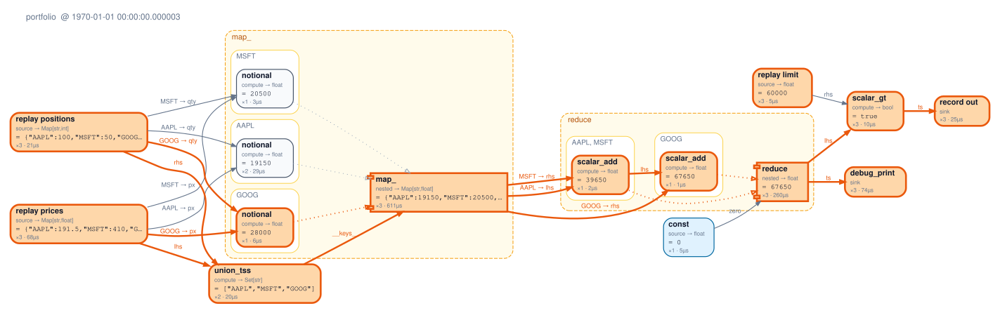
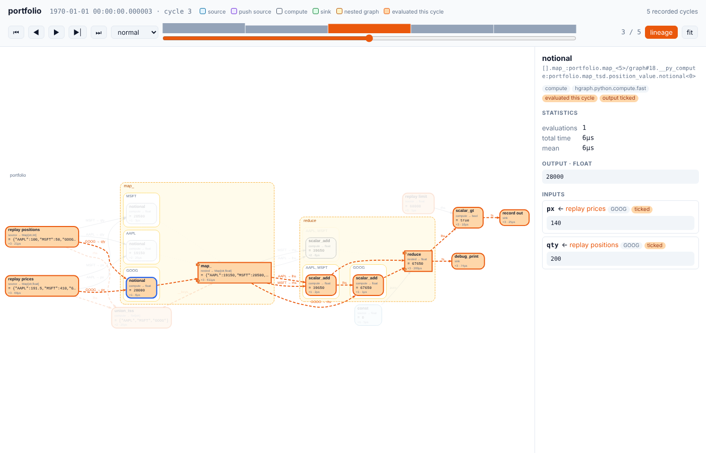

# hg_viz

Visual introspection for running [hgraph](https://github.com/hhenson/hgraph) graphs.

`hg_viz` attaches to a graph as a lifecycle observer, records the runtime
topology after every engine cycle, and renders it with Graphviz so you can see
**what is wired to what, which nodes evaluated in a cycle, and which edges
carried data**. Nested graphs from `map_`, `reduce`, `switch_` and similar
operators are drawn as clusters, one per live instance, labelled with the key
each instance serves.



*One engine cycle of [`examples/trading.py`](examples/trading.py). Orange nodes
evaluated, orange edges carried a tick in that cycle. Each node shows its role,
output type, current value, evaluation count and the time spent in it. Edge
labels show `output path → input`: `GOOG → px` means the `px` input of the GOOG
instance is bound to the `GOOG` element of the prices TSD. Dotted edges run from
an instance's result to the nested node that publishes it.*

## Install

```bash
pip install -e .             # needs hgraph >= 0.8
# optional, for SVG/PNG/PDF output and an embedded layout in the HTML viewer:
apt install graphviz         # or: brew install graphviz / conda install graphviz
```

Without the Graphviz `dot` binary you still get DOT text, and the HTML viewer
lays out the graph in the browser with [viz.js](https://github.com/mdaines/viz-js).

## Usage

### Record a run

```python
from hg_viz import GraphRecorder, record

# eval_node style: positional args are the input tick sequences
rec, result = record(my_graph, [1, 2, 3], [10, None, 30])

# or attach the recorder to any run yourself
rec = GraphRecorder()
run_graph(my_graph, start_time=..., end_time=..., life_cycle_observers=rec.observers)
eval_node(my_graph, ..., __observers__=rec.observers)
```

### Look at it

```python
rec.write("graph.svg")                  # final state: topology, values, stats
rec.write("cycle3.png", frame=2)        # one cycle with its data flow highlighted
rec.write("hot.svg", heat="time")       # colour nodes by time spent (or heat="count")
rec.write_html("flow.html")             # interactive player for every cycle
rec.view()                              # inline SVG in Jupyter
print(rec.summary())                    # the busiest nodes, as text
print(rec.to_dot())                     # raw DOT text
```

`flow.html` is a single self-contained file:



* play, step (← / →) or scrub through the recorded engine cycles. The bar
  chart above the slider shows how many nodes evaluated in each cycle;
* nodes that evaluated light up and edges whose source ticked animate. Values
  and evaluation counts update in place. Nested-graph instances that don't
  exist yet, or have been torn down, fade out;
* click a node to see its output, each input with the node it comes from and
  whether it ticked, its consumers, and its timings;
* **lineage** dims everything that isn't upstream or downstream of the
  selected node, so you can trace one value through the graph;
* scroll to zoom, drag to pan, and press `f` to fit the graph to the window.

### Watch a live (real-time) graph

```python
from hg_viz import GraphRecorder, serve

rec = GraphRecorder(min_interval=0.1)       # at most 10 snapshots per second
srv = serve(rec, port=8765, open_browser=True)
run_graph(app, run_mode=EvaluationMode.REAL_TIME, end_time=..., life_cycle_observers=rec.observers)
```

The viewer follows the latest cycle and lays the graph out again when new
nodes appear, for example when a `map_` key is added. The server also provides
`/api/frames?after=N`, `/api/topology` and `/api/model` as JSON. See
[`examples/live_realtime.py`](examples/live_realtime.py).

### Rendering options

`to_dot`, `rec.to_dot` and `rec.write` accept `DotOptions` fields as keyword
arguments:

| option | default | meaning |
|---|---|---|
| `expand_nested` | `True` | draw nested graphs as clusters; `False` draws one box per nested node |
| `max_instances` | `4` | nested instances drawn per nested node; the rest are summarised as "+N more" |
| `show_values` / `show_types` / `show_stats` | `True` | the label lines shown in each node |
| `heat` | `None` | `"count"` or `"time"` colours nodes on a log scale |
| `hide_harness` | `False` | hide the replay/record nodes that `eval_node` and `run_graph` add |
| `hide_stopped` | `True` | drop nested instances that have been torn down |
| `rankdir` | `"LR"` | Graphviz direction (`"TB"` for top to bottom) |
| `palette` | `Palette()` | colours |

Recorder options: `GraphRecorder(capture_values=True, every=1, min_interval=0.0, max_frames=2000)`.
Capturing values serialises every port on each captured cycle. For large or
fast graphs, sample with `every=` or `min_interval=`, or pass
`capture_values=False` to record topology and statistics only.

### Programmatic introspection

The model behind the pictures is plain Python:

```python
m = rec.model()                         # or rec.frames[i].model
n = m.find("notional")[0]
m.upstream(n.id), m.downstream(n.id), m.edges_into(n.id)
n.output.value, n.input_fields(), n.eval_count, n.eval_time
frame = rec.frames[2]
frame.evaluated, frame.ticked, frame.active_edges
```

`hg_viz.from_snapshot(snapshot)` converts any
`hgraph.debug.GraphDiagnostics().snapshot()`, so you can also use it with
diagnostics you collect yourself.

## How it works

hgraph's C++ runtime provides `GraphDiagnostics`, a lifecycle observer. Its
snapshots list every graph and node, including nested graph instances, with
their input, output and scalar values, evaluation statistics and the
**resolved input bindings**: for each input, the node and output path it reads
from. `hg_viz`:

1. reads one snapshot after each root-graph evaluation;
2. turns it into a `GraphModel` of nodes and edges. Per-key bindings of a TSD
   are folded into a single collection edge, and each nested instance is
   labelled with the keys it serves;
3. compares it with the previous frame to find the nodes that evaluated, the
   outputs that were modified, and the edges whose source ticked in that cycle;
4. writes DOT. The HTML viewer lays out the union of every frame once, so the
   picture stays still while you step, and replays each frame's state on top.

## Development

```bash
pip install -e ".[test]"
pytest
python examples/trading.py docs   # regenerate the README images
```
